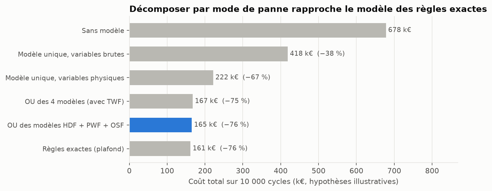
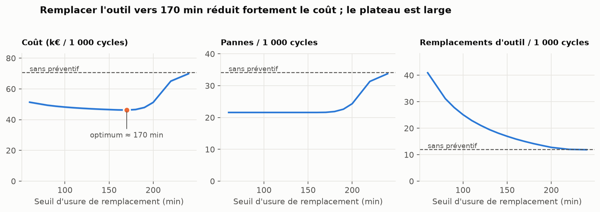

# Maintenance prédictive et analyse de fiabilité — jeu AI4I 2020

Projet de data science de bout en bout sur le jeu public [AI4I 2020 Predictive Maintenance](https://archive.ics.uci.edu/dataset/601/ai4i+2020+predictive+maintenance+dataset) (UCI n° 601) : collecte et structuration en **SQL**, contrôle qualité, **modèles de machine learning** validés de façon adaptée aux données temporelles, **simulation Monte Carlo** de la fiabilité et comparaison de **politiques de maintenance**, avec une traduction en recommandations de décision.

> **Avertissement.** Le jeu est **synthétique** : il imite des données industrielles sans en être. Ce projet démontre une **méthode**, pas un résultat sur un vrai parc de machines. Les coûts utilisés (panne 2 000 €, changement d'outil 200 €, intervention sur alerte 200 €) sont des **hypothèses illustratives** : le jeu n'en contient aucun.

## Résultats principaux

| Question | Réponse |
|---|---|
| Le fichier correspond-il à sa description ? | Non, sur plusieurs points : types L/M/H à 60 % / 30 % / 10 % (et non 50/30/20), 46 TWF (et non 51), 19 RNF (et non 5), 9 pannes sans mode renseigné, 18 modes sans panne. Les règles HDF, PWF et OSF sont reproduites **exactement** (0 écart). |
| Une validation croisée classique suffit-elle ? | Non. Températures autocorrélées à 0,999 et **un seul épisode** concentre 108 des 115 HDF. Avec les variables brutes, l'AP du gradient boosting passe de 0,80 (validation aléatoire) à 0,57 (validation par blocs). Avec les variables physiques : 0,90 → 0,87. |
| Un modèle détecte-t-il un épisode jamais vu ? | Entraîné sans l'épisode (seulement 7 HDF isolés), le modèle HDF à variables physiques détecte **108 des 108** HDF de l'épisode, avec 0 fausse alerte ; avec les variables brutes : 19 sur 108. |
| Quelle stratégie de modèle ? | Un modèle **par mode de panne**, combinés par un « OU », atteint une précision de 0,997 et un rappel de 0,841, pour un coût de 165 k€ contre 222 k€ pour un modèle binaire unique, 161 k€ pour les règles exactes et 678 k€ sans modèle (hypothèses illustratives). |
| Que reste-t-il d'imprévisible ? | Les pannes **TWF** et « inexpliquées » (~15 % des pannes) : précision moyenne de TWF proche de sa prévalence. Aucun modèle ne les rattrape avec ces capteurs. |
| Que vaut le simulateur ? | Sur 2 000 fenêtres simulées de 10 000 cycles : 339,4 pannes en moyenne contre 339 observées ; HDF, PWF, OSF dans leur zone plausible ; écart max des répartitions 0,3 % (usure) et 1,2 % (vitesse). |
| Quelle politique de maintenance ? | Remplacer l'outil vers **170 min** : 46,2 k€ / 1 000 cycles contre 70,5 k€ sans préventif (**−34 %**). Coût à moins de 1 % de l'optimum entre 150 et 180 min. Le seuil optimal reste entre 160 et 180 min quand le ratio coût de panne / coût de changement varie de 2 à 100 (économie de 28 % à 36 %). |

### Comparaison des stratégies (validation par blocs, seuil choisi hors-échantillon)

| Stratégie | Précision | Rappel [IC95] | Coût sur 10 000 cycles |
|---|---|---|---|
| Sans modèle | — | — | 678 k€ |
| Modèle unique, variables brutes | 0,232 | 0,673 [0,51 ; 0,92] | 418 k€ |
| Modèle unique, variables physiques | 0,659 | 0,794 [0,72 ; 0,85] | 222 k€ |
| OU des 4 modèles (avec TWF) | 0,932 | 0,844 [0,76 ; 0,89] | 167 k€ |
| OU des modèles HDF + PWF + OSF | 0,997 | 0,841 [0,76 ; 0,89] | 165 k€ |
| Règles exactes (plafond) | 1,000 | 0,847 [0,77 ; 0,90] | 161 k€ |

IC95 : bootstrap par blocs de 500 cycles (respecte l'autocorrélation). Coût = intervention sur chaque alerte (vraie ou fausse) + panne manquée.




## Démarche

1. **Données et SQL** (`src/ai4i/data.py`, `sql/queries.sql`). Chargement dans SQLite, contrôles de cohérence, requêtes d'agrégation et de fenêtrage (`OVER`, `LAG`) : taux de panne par type et par tranche d'usure, cohérence des labels, reconstitution de la vie des outils.
2. **Variables** (`src/ai4i/features.py`). Brutes (capteurs, type) contre physiques (écart de température, puissance, usure × couple, marge de surcharge), sans aucun label.
3. **Validation** (`src/ai4i/modeling.py`). Validation par **10 blocs temporels contigus avec zone tampon** (contre 5 plis aléatoires pour comparaison), métrique AP adaptée au déséquilibre (3,4 % de pannes), IC par bootstrap par blocs. Le seuil de décision de chaque modèle est choisi sur les autres blocs, puis appliqué au bloc évalué.
4. **Un modèle par mode de panne**, combinés par un « OU » ; importance par permutation mesurée sur les blocs test (chaque modèle s'appuie sur la grandeur physique de son mécanisme ; TWF sur aucune).
5. **Simulation Monte Carlo** (`src/ai4i/simulation.py`). Générateur ajusté sur les données (usure +2/+3/+5 min selon le type, fin de vie d'outil empirique, couple/puissance normaux bivariés, ΔT en AR(1)), **validé** contre les données, puis utilisé pour comparer des politiques de remplacement préventif avec des nombres aléatoires communs. L'initialisation stationnaire est indispensable : sans elle, les remplacements restent synchronisés et biaisent les comptages (défaut trouvé et corrigé pendant le projet, couvert par un test contre la théorie du renouvellement).

## Structure du dépôt

```
ai4i-maintenance/
├── README.md
├── requirements.txt
├── data/ai4i2020.csv            # jeu UCI n° 601 (CC BY 4.0)
├── sql/queries.sql              # requêtes d'analyse
├── src/ai4i/                    # data, features, modeling, simulation, plots, config
├── notebooks/ai4i_predictive_maintenance.ipynb   # analyse complète, exécutée
├── reports/
│   ├── ai4i_predictive_maintenance.html          # même notebook, lisible dans un navigateur
│   ├── results.json             # tous les chiffres calculés par le notebook
│   └── figures/                 # 9 graphiques
└── tests/test_project.py        # 11 tests (règles, validation, simulateur)
```

## Reproduire

```bash
pip install -r requirements.txt
python -m pytest -q                                  # ~3 s
jupyter nbconvert --to notebook --execute --inplace notebooks/ai4i_predictive_maintenance.ipynb   # ~3 min
```

Environnement de développement : Python 3.13, pandas 3.0.5, scikit-learn 1.9.1, NumPy 2.5.3. Graines fixées : les résultats sont identiques d'une exécution à l'autre.

## Limites

- **Données synthétiques** : la facilité de prédiction de HDF, PWF et OSF (règles déterministes) ne se transpose pas à un vrai parc.
- **Étiquettes de mode** : l'approche « un modèle par mode » suppose un label par mécanisme, donc en pratique une analyse de causes racines.
- **Coûts illustratifs** : à remplacer par ceux d'un client ; la sensibilité montre quoi attendre.
- **Simulateur** : cycles supposés indépendants hors usure et ΔT ; un remplacement d'outil ne modifie pas HDF/PWF ; la distribution de fin de vie repose sur 119 observations (incertitude d'échantillonnage non propagée) ; TWF et pannes inexpliquées sont *calibrées* sur les données, pas vérifiées de façon indépendante.
- **Suites possibles** : politique préventive et alertes combinées dans la simulation ; incertitude sur les paramètres du générateur ; modèles de survie pour la fin de vie de l'outil.

## Données et licence

S. Matzka, *AI4I 2020 Predictive Maintenance Dataset*, UCI Machine Learning Repository, 2020. [doi:10.24432/C5HS5C](https://doi.org/10.24432/C5HS5C). Licence [CC BY 4.0](https://creativecommons.org/licenses/by/4.0/). Article associé : S. Matzka, *Explainable Artificial Intelligence for Predictive Maintenance Applications*, International Conference on Artificial Intelligence for Industries, 2020.
